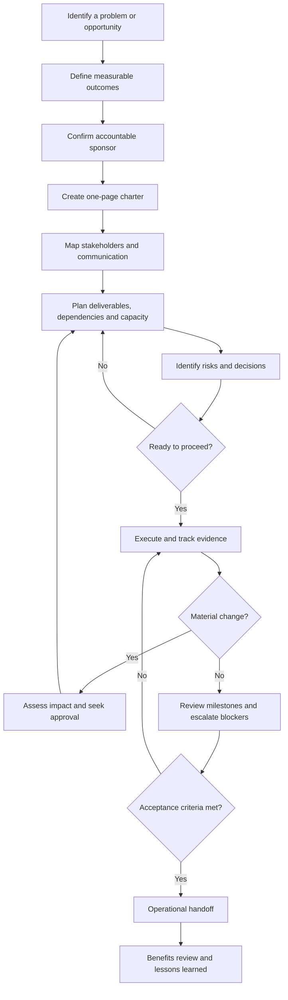

# PMO First Principles — from idea to sustainable outcome

This is an original teaching diagram, not an OSU document or approved employer policy.

## Apply the workflow

Use [the charter](../templates/01-project-charter.md) when defining outcomes, the [milestone plan](../templates/03-milestone-plan.md) for schedule and dependencies, the [RAID log](../templates/04-raid-log.md) to track uncertainty, and the [operational handoff](../templates/07-operational-handoff.md) before closing the project. The public [learning academy](https://dietricheubank.github.io/pmo-first-principles/) covers all stages.
